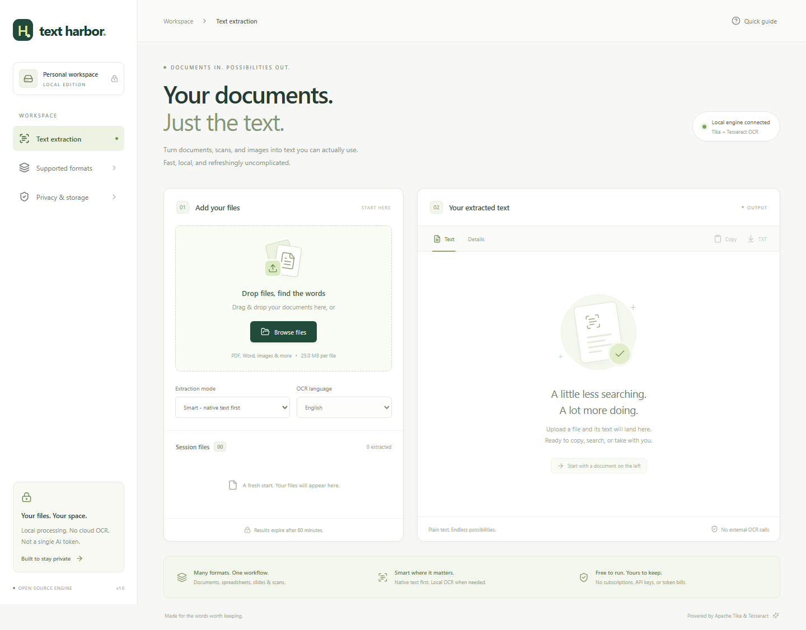

# Text Harbor

**Your documents. Just the text.**

A React + Java Spring Boot workspace for extracting text from documents, scans
and images. Apache Tika reads native content; Tesseract performs local OCR.
No paid APIs, API keys, subscriptions or LLM tokens.



## What it does

- Drag-and-drop batches, live job states and tab-scoped history.
- Native text from PDF, Word, spreadsheets, presentations, text, HTML, email and more.
- Local image OCR and scanned-PDF OCR, including English and Hindi language options.
- Smart/native-first, whole-page PDF OCR, and native-only modes.
- Copy text, download UTF-8 TXT or structured JSON, cancel jobs and delete results.
- Bounded worker queue, separate parser JVMs, output limits and explicit partial results.
- Restart-persistent job metadata, per-job access tokens and automatic retention cleanup.
- Responsive interface with no external fonts, CDN scripts or analytics.

**Honest scope:** not every binary file contains extractable text. Unsupported,
encrypted, damaged and unreadable files get errors or warnings. OCR accuracy,
perfect reading order and exact document layout are not guaranteed. Audio/video
transcription is not implemented. This is a **trusted local-workspace release**,
not an authenticated multi-tenant SaaS.

## Quick start: local containers

Use **Podman with a Compose provider**, or free **Docker Engine + Compose** on
Linux. Check Docker Desktop's license separately if choosing it; it is not a
required dependency.

```console
git clone https://github.com/primaurya_microsoft/text-harbor.git
cd text-harbor
podman compose up --build
```

Or, with Docker Engine:

```console
docker compose up --build
```

Open **http://localhost:8080**. Container builds include Java, Node and English +
Hindi OCR models; there are no credentials to configure. The first build requires
internet access to download free dependencies. After building, processing needs
no internet. The backend runs on an internal container network without normal
external egress. Only the frontend's loopback port is published.

Stop with `podman compose down` or `docker compose down`. The named data volume
is retained; do not add `--volumes` unless you intend to remove stored results.

The native Windows route below was exercised end to end. Container definitions
are supplied, but a container engine was not available on the build machine's
PATH for a container-runtime validation.

## Run without containers

Requirements: **JDK 21**, **Node 22.12+**, and **Tesseract 5** for image/scanned
document OCR. Maven is provided by the checked-in wrapper. Tesseract is optional
for native text extraction; the UI explicitly shows when OCR is unavailable.

### Windows / PowerShell

Install a free JDK such as [Eclipse Temurin](https://adoptium.net/), Node.js, and
the [Tesseract Windows build](https://github.com/UB-Mannheim/tesseract/wiki).
Select/install the Hindi language data if needed. `TESSERACT_PATH` is the
**directory** containing `tesseract.exe`, not the executable itself.

Backend terminal:

```powershell
cd 'C:\path\to\text-harbor\backend'
$env:JAVA_HOME = 'C:\path\to\jdk-21'
$env:TESSERACT_PATH = 'C:\Program Files\Tesseract-OCR'
$env:PATH = "$env:JAVA_HOME\bin;$env:TESSERACT_PATH;$env:PATH"
tesseract --list-langs
.\mvnw.cmd clean package
java -jar target\text-harbor.jar
```

Frontend terminal:

```powershell
cd 'C:\path\to\text-harbor\frontend'
npm ci
npm run dev
```

Open **http://localhost:5173**. The Vite development proxy forwards `/api` to the
backend at `127.0.0.1:8080`; OCR never runs on the React UI thread.

### macOS

With Homebrew:

```sh
brew install openjdk@21 node@22 tesseract tesseract-lang
export JAVA_HOME="$(brew --prefix openjdk@21)/libexec/openjdk.jdk/Contents/Home"
export TESSERACT_PATH="$(brew --prefix tesseract)/bin"
export PATH="$JAVA_HOME/bin:$(brew --prefix node@22)/bin:$TESSERACT_PATH:$PATH"
cd backend
./mvnw clean package
java -jar target/text-harbor.jar
```

Run `npm ci` and `npm run dev` in the `frontend` directory in a second terminal.

### Linux

On Ubuntu 24.04, install `openjdk-21-jdk`, `tesseract-ocr`,
`tesseract-ocr-eng`, `tesseract-ocr-hin` and `fonts-dejavu-core`; install Node 22
from your preferred supported distribution. Run the same Maven-wrapper and npm
commands as above. Set `JAVA_HOME` to your JDK location.

## Supported content and extraction modes

| Input | Processing |
|---|---|
| Digital PDF | Native text via Tika/PDFBox |
| Scanned or mixed-page PDF | Tika's per-page AUTO OCR strategy |
| DOC/DOCX, XLS/XLSX, PPT/PPTX | Tika/Apache POI, including supported embedded content |
| ODF, RTF, EPUB | Format-specific Tika parsers |
| TXT, CSV, JSON, XML, HTML, Markdown | Native text parsing |
| EML/MSG | Supported message content and attachments |
| ZIP/TAR and supported archives | Bounded embedded-document parsing; no extraction to user-selected paths |
| PNG/JPEG/TIFF/BMP and decodable supported images | Local Tesseract OCR |

Tika detects file contents, rather than trusting the browser-supplied MIME type.
Support varies for unusual variants, old Office documents and image codecs.
See [Apache Tika's format documentation](https://tika.apache.org/3.3.2/formats.html).

**Smart mode** avoids unnecessary full-page OCR when a PDF already has usable
text. Tika's AUTO heuristic is not a completeness guarantee: a page with native
text plus a screenshot can omit screenshot text. Select **whole-page PDF OCR**
for that case. It OCRs the rendered page instead of concatenating two full-page
transcripts. For non-PDF inputs, this option still uses their normal parser/OCR.

**Native only** skips image OCR. Scanned content may be absent; relevant warnings
are preserved. Do not interpret `COMPLETED` as a claim of OCR accuracy.

Only installed OCR languages appear in the dropdown. Containers bundle `eng`
and `hin`; English + Hindi is offered when both are present. Handwriting support
is limited. Check names, identifiers, dates and amounts against the source.

## Architecture and limits

```text
React browser UI
      | same-origin HTTP /api
Spring Boot upload + job API
      | bounded queue, 2 workers
Isolated Java parser process (512 MiB heap)
      | Apache Tika / PDFBox / POI -> local Tesseract when needed
Private disk results -> token-protected JSON/TXT -> browser
```

| Default limit | Value |
|---|---|
| File size | 25 MiB |
| Files selected per browser batch | 8 |
| Concurrent workers / queued jobs | 2 / 8 |
| PDF pages / top-level image frames | 200 |
| Top-level image frame / rendered PDF page | 40 million pixels |
| Text output | 1,000,000 UTF-16 code units |
| Embedded documents | 100 per extraction |
| Worker deadline / individual OCR timeout | 120 seconds / 45 seconds |
| Stored jobs / result retention | 100 / 60 minutes |

Page/pixel preflight checks apply to the top-level PDF/image. Embedded documents
also have parser safeguards, the embedded-item cap, worker deadline and memory
limits, but do not get an independent per-document page/pixel preflight.
Text or attachment limits produce an explicit partial result when text exists.
Empty results are failures, not successful blank downloads.

Completed results are written before their status is published. On restart,
interrupted jobs become explicit failures; completed jobs remain available.
Expired jobs are removed by a one-minute cleanup sweep while the server runs.
Original uploads are removed after processing; queued files remain until
processed, cancelled or cleaned up after restart.

By default native-mode data lives in **`~/.text-harbor/data`**, outside the project
and OneDrive checkout. Containers use `/data`. The directory must be on a private,
non-synchronized disk if your privacy requirements forbid cloud synchronization.
Job tokens are stored as hashes on the server, and as capabilities in browser
session storage. They are never placed in download URLs.

### Configuration

| Environment variable | Purpose |
|---|---|
| `JAVA_HOME` | JDK used by the Maven wrapper |
| `TESSERACT_PATH` | Directory containing the Tesseract executable; otherwise use PATH |
| `TEXT_HARBOR_STORAGE` | Private persistent job/result directory |
| `PORT` | Backend port; default `8080` |
| `SERVER_ADDRESS` | Backend bind address; default `127.0.0.1` |
| `BACKEND_URL` | Vite proxy destination if using a different backend port |

Additional Spring configuration lives in
`backend/src/main/resources/application.yml`. If changing the file-size limit,
also update Spring multipart limits and the Nginx request limit. Do not expose
arbitrary parser configurations or executable paths to upload clients.

## API

| Method | Route | Result |
|---|---|---|
| GET | `/api/capabilities` | Limits, OCR availability, installed languages |
| POST | `/api/jobs` | Multipart `file`, `language`, `ocrMode`; returns `202` with job + access token |
| GET | `/api/jobs/{id}` | Job status and metadata |
| GET | `/api/jobs/{id}/result` | Text, detected media type and warnings |
| GET | `/api/jobs/{id}/download` | UTF-8 TXT attachment |
| POST | `/api/jobs/{id}/cancel` | Cancels queued/active work |
| DELETE | `/api/jobs/{id}` | Deletes a stopped/completed job and stored result |

All job-specific routes require **`X-Job-Token`**. Missing/wrong tokens receive
404. This is capability-based access to a job, not user authentication. There is
no unauthenticated list-all-jobs endpoint.

States: `QUEUED`, `PROCESSING`, `COMPLETED`, `PARTIAL`, `FAILED`, `CANCELLED`.
Errors include `UNSUPPORTED_FORMAT`, `ENCRYPTED_DOCUMENT`, `NO_TEXT_FOUND`,
`OCR_UNAVAILABLE`, `PAGE_LIMIT`, `IMAGE_LIMIT`, `QUEUE_FULL` and `TIMEOUT`.

## Verification

Backend tests cover native Office/PDF extraction, Unicode, archives, disabled
external XML entities, limits, encryption, local OCR, queue backpressure,
cancellation, access tokens and restart persistence.

```powershell
# backend: include Tesseract in PATH to run the real OCR test and generate fixtures
.\mvnw.cmd test

# frontend
npm run build
npm test
npx playwright install chromium
# Start backend and frontend, then:
npm run test:e2e
```

The OCR test requires `TESSERACT_PATH` to be set **and** that directory on PATH.
Without it, native tests run but the real OCR fixture test is skipped. Browser
OCR tests require its generated files in `backend/target/smoke-fixtures`.
`TEXT_HARBOR_URL` can override the browser-test base URL.

No automatic GitHub Actions workflow or cloud deployment is enabled. This avoids
silently consuming hosted CI allowances or provisioning billable resources.
Running locally still uses your machine's CPU, memory, storage and electricity.

## Before exposing it publicly

Keep the defaults on loopback for personal use. For a public service, add
authentication/tenant ownership, upload rate limits, malware scanning, TLS,
storage quotas, monitoring and a stricter OS/container sandbox. Native parser
processes are resource-isolated, **not a complete security boundary**. Archive
decompression, retention and dependency-update policies need operational review.
Do not advertise this local release as a production-hardened public SaaS.

## Project milestones

1. Repository and dependency foundation.
2. [M1: extraction backend](https://github.com/primaurya_microsoft/text-harbor/milestone/1).
3. [M2: React workspace](https://github.com/primaurya_microsoft/text-harbor/milestone/2).
4. [M3: verified local release](https://github.com/primaurya_microsoft/text-harbor/milestone/3).

See the Git history for the incremental implementation commits.

## License

Application code: [MIT](LICENSE). Third-party projects keep their respective
licenses; see [THIRD_PARTY_NOTICES.md](THIRD_PARTY_NOTICES.md).
